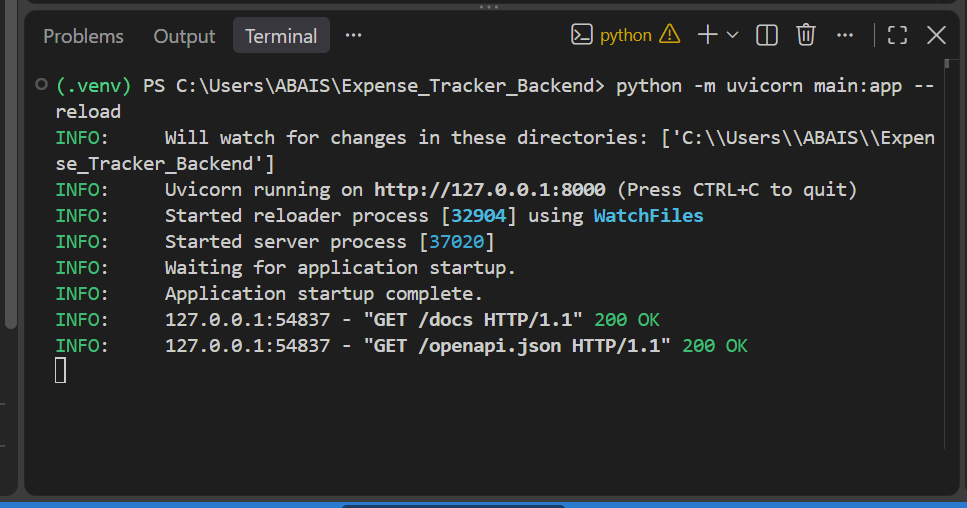
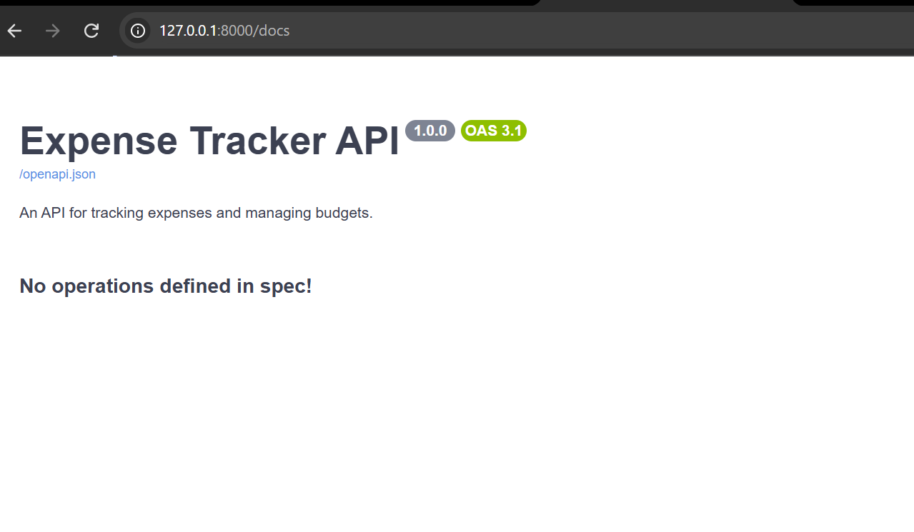

# Feature 00: Initialize FastAPI Application

**Project:** Expense Tracker API  
**Course:** Backend Engineering 101  
**Practice:** 01 — FastAPI Application Initialization  
**Status:** Completed  
**Technologies:** Python, FastAPI, Uvicorn, ASGI, Swagger UI  
**Development Environment:** Windows, PowerShell, VS Code

---

## 1. Requirement

### 1.1 Problem Statement

The Expense Tracker API requires a backend application capable of
receiving HTTP requests, processing them, and returning HTTP responses.

Before implementing expense management functionality, we need to
establish the foundation of the backend application.

The application will use FastAPI as the web framework and Uvicorn
as the ASGI application server.

This initial implementation focuses on configuring and running the
application rather than implementing expense-related endpoints.

### 1.2 Functional Requirements

The application must:

1. Initialize a FastAPI application instance.
2. Configure application metadata, including title, description,
   and version.
3. Run locally using Uvicorn.
4. Provide automatically generated interactive API documentation.
5. Expose an OpenAPI specification.

### 1.3 Non-Functional Requirements

The application should:

1. Use an isolated Python virtual environment.
2. Maintain a simple and organized project structure.
3. Support automatic application reloading during development.
4. Start without application errors.
5. Be accessible through localhost.

### 1.4 Acceptance Criteria

The implementation is considered successful when:

- [x] FastAPI application initializes successfully.
- [x] Uvicorn starts without application errors.
- [x] Swagger UI is accessible at `/docs`.
- [x] Application metadata is displayed correctly.
- [x] OpenAPI specification is accessible at `/openapi.json`.

---

## 2. Logic

### 2.1 Implementation Approach

The goal is to establish a working FastAPI application before
implementing individual API endpoints.

The implementation involves creating an application instance,
configuring its metadata, running it through an ASGI server,
and verifying that it responds correctly.

### 2.2 Pseudocode

START

1. Import the FastAPI class.

2. Create a FastAPI application instance.

3. Configure the application:
   - Title: Expense Tracker API
   - Description: Backend Engineering 101 Expense Tracker
   - Version: 1.0.0

4. Save the application in main.py.

5. Start the application using Uvicorn.

6. Verify that Uvicorn successfully imports the application.

7. Open Swagger UI in a browser.

8. Verify the application metadata.

9. Verify that the OpenAPI specification is accessible.

END

### 2.3 Application Flow

```text
Developer
    |
    | Starts Uvicorn
    v
Uvicorn ASGI Server
    |
    | Imports main.py
    v
FastAPI Application
    |
    | Initializes application configuration
    v
HTTP Server Ready
    |
    | GET /docs
    v
Swagger UI
    |
    v
Developer Verifies Application
```

### 2.4 Components Used

| Component | Responsibility | Problem Solved |
|-----------|----------------|----------------|
| Python | Backend programming language | Provides the application implementation |
| FastAPI | Web framework | Defines HTTP API behavior |
| Uvicorn | ASGI application server | Runs the application and handles HTTP connections |
| ASGI | Server-application interface | Enables communication between Uvicorn and FastAPI |
| Swagger UI | Interactive API documentation | Allows developers to explore and test the API |
| OpenAPI | API specification | Provides a standardized description of the API |

### 2.5 Design Decisions

**Why FastAPI?**

FastAPI provides functionality for implementing HTTP APIs,
including routing, request validation, dependency injection,
response serialization, and automatic API documentation.

**Why Uvicorn?**

FastAPI defines application behavior but requires an ASGI
server to receive HTTP connections and run the application.

Uvicorn provides that server functionality.

**Why configure application metadata?**

Application metadata makes the API identifiable and provides
important information to developers through Swagger UI
and the OpenAPI specification.

---

## 3. Code

### 3.1 Project Structure

```text
expense-tracker-api/
│
├── main.py
├── README.md
├── .gitignore
│
└── docs/
    ├── assets/
    │   └── images/
    │       └── feature-00/
    │           ├── uvicorn-startup.png
    │           └── swagger-ui.png
    │
    └── implementation/
        └── 00-fastapi-setup.md
```

### 3.2 Implementation

**File:** `main.py`

```python
from fastapi import FastAPI

app = FastAPI(
    title="Expense Tracker API",
    description="Backend Engineering 101 Expense Tracker",
    version="1.0.0"
)
```

### 3.3 Code Explanation

#### Import FastAPI

```python
from fastapi import FastAPI
```

**What:**

Imports the FastAPI class from the FastAPI package.

**Why:**

We need the framework to create and configure our backend application.

**Problem Solved:**

Provides the foundation for implementing HTTP API functionality.

#### Create the Application Instance

```python
app = FastAPI(...)
```

**What:**

Creates an instance of the FastAPI application.

**Why:**

The application instance is the central object used to
register endpoints and configure application behavior.

**How:**

Python creates a FastAPI object and assigns it to the variable `app`.

Uvicorn imports this object when starting the application.

**Problem Solved:**

Establishes an application object that can be executed
by an ASGI server.

#### Configure Application Metadata

```python
title="Expense Tracker API"
```

Defines the name displayed in the API documentation.

```python
description="Backend Engineering 101 Expense Tracker"
```

Provides a description of the application's purpose.

```python
version="1.0.0"
```

Defines the version included in the OpenAPI metadata.

This version identifies the documented application release.
It does not automatically implement URL-based API versioning.

### 3.4 Run the Application

Activate the Python virtual environment:

```powershell
.\.venv\Scripts\Activate.ps1
```

Start Uvicorn:

```powershell
python -m uvicorn main:app --reload
```

### 3.5 Uvicorn Command Explanation

| Component | Purpose |
|-----------|---------|
| `python -m` | Executes an installed Python module |
| `uvicorn` | Starts the ASGI application server |
| `main` | Python module containing the application |
| `app` | FastAPI application instance |
| `--reload` | Restarts the development server when watched files change |

**Understanding `main:app`:**

`main` refers to the Python module `main.py`.

`app` refers to the FastAPI application instance defined
inside that module.

Uvicorn imports the application and runs it through ASGI.

---

## 4. Test

### 4.1 Testing Objective

Verify that the FastAPI application initializes correctly,
runs successfully using Uvicorn, and exposes its
automatically generated API documentation.

Testing was performed locally using PowerShell,
Uvicorn, and a web browser.

### 4.2 Test Environment

| Component | Configuration |
|-----------|---------------|
| Operating System | Windows |
| Development Environment | VS Code |
| Terminal | PowerShell |
| Framework | FastAPI |
| Application Server | Uvicorn |
| Host | 127.0.0.1 |
| Port | 8000 |
| Testing Interface | Browser / Swagger UI |

### 4.3 Test Cases

#### TC-001: Application Startup

**Objective:**

Verify that Uvicorn successfully starts the FastAPI application.

**Command:**

```powershell
python -m uvicorn main:app --reload
```

**Expected Result:**

```text
INFO: Uvicorn running on http://127.0.0.1:8000
INFO: Application startup complete.
```

**Actual Result:**

The FastAPI application started successfully without errors.

**Status:** PASS

---

#### TC-002: Swagger UI Accessibility

**Objective:**

Verify that the application exposes interactive API documentation.

**Request:**

```http
GET http://127.0.0.1:8000/docs
```

**Expected Result:**

- HTTP 200 OK.
- Swagger UI loads successfully.

**Actual Result:**

Swagger UI loaded successfully in the browser.

**Status:** PASS

---

#### TC-003: Application Metadata

**Objective:**

Verify that the configured application metadata appears correctly.

**Expected Result:**

- Title: Expense Tracker API
- Description: Backend Engineering 101 Expense Tracker
- Version: 1.0.0

**Actual Result:**

The application metadata matched the configured values.

**Status:** PASS

---

#### TC-004: OpenAPI Specification

**Objective:**

Verify that FastAPI exposes its OpenAPI specification.

**Request:**

```http
GET http://127.0.0.1:8000/openapi.json
```

**Expected Result:**

- HTTP 200 OK.
- Valid OpenAPI JSON document.
- Correct application metadata.

**Actual Result:**

The OpenAPI specification was accessible and contained
the configured application metadata.

**Status:** PASS

---

#### TC-005: Undefined Root Endpoint

**Objective:**

Verify how FastAPI responds to an undefined route.

**Request:**

```http
GET http://127.0.0.1:8000/
```

**Expected Result:**

HTTP 404 Not Found.

The root endpoint has not yet been implemented.

**Actual Result:**

The server returned HTTP 404 Not Found.

**Status:** PASS

---

### 4.4 Test Summary

| Test ID | Description | Expected Result | Status |
|---------|-------------|-----------------|--------|
| TC-001 | Application startup | Successful startup | PASS |
| TC-002 | Swagger UI | HTTP 200 OK | PASS |
| TC-003 | Application metadata | Correct configuration | PASS |
| TC-004 | OpenAPI specification | HTTP 200 OK | PASS |
| TC-005 | Undefined root endpoint | HTTP 404 Not Found | PASS |

**Total Tests:** 5  
**Passed:** 5  
**Failed:** 0  

**Overall Result:** PASS

All five defined test cases were completed successfully.

---

### 4.5 Test Evidence

The following screenshots provide supporting evidence of
the successful implementation and local verification.

#### Evidence 1: Uvicorn Server Startup



**Related Test:** TC-001

**Description:**

The screenshot shows the Uvicorn server running locally.

The terminal confirms that the FastAPI application completed
startup successfully without application errors.

**Verification:**

- Uvicorn started successfully.
- The application was accessible on localhost.
- Application startup completed without errors.

---

#### Evidence 2: FastAPI Swagger UI



**Related Tests:** TC-002 and TC-003

**Description:**

The screenshot shows the automatically generated FastAPI
Swagger UI displaying the Expense Tracker API information.

**Verification:**

- Swagger UI loaded successfully.
- Application title was displayed correctly.
- Application description was displayed correctly.
- Application version was displayed correctly.

---

### 4.6 Test Evidence Summary

| Evidence | Related Test | Verification |
|----------|--------------|--------------|
| Uvicorn startup screenshot | TC-001 | Application startup successful |
| Swagger UI screenshot | TC-002, TC-003 | Documentation and metadata verified |
| OpenAPI JSON response | TC-004 | OpenAPI specification accessible |
| HTTP 404 response | TC-005 | Undefined route handled correctly |

**Note:** Screenshots provide visual evidence.
The recorded HTTP responses and test results provide
additional verification of application behavior.

---

## 5. Lessons Learned

### 5.1 FastAPI and Uvicorn Have Different Responsibilities

FastAPI defines API functionality and application behavior.

Uvicorn runs the FastAPI application and handles HTTP
connections through the ASGI interface.

Both components work together to serve HTTP requests.

### 5.2 The Application Instance Is the Foundation

The FastAPI application instance is the central object
used to register routes and configure application behavior.

Future expense-related endpoints will be added to
this application.

### 5.3 FastAPI Automatically Generates API Documentation

FastAPI generates an OpenAPI specification based on
the application configuration and registered endpoints.

Swagger UI provides a graphical interface for developers
to explore and test these endpoints.

### 5.4 An Application Can Start Without Custom Endpoints

The FastAPI application successfully started without
any user-defined routes.

The built-in documentation endpoints remained accessible.

Requests to undefined routes returned HTTP 404.

### 5.5 HTTP Status Codes Describe Request Results

A successful request to Swagger UI returned HTTP 200.

A request to the undefined root endpoint returned HTTP 404.

This demonstrates how HTTP status codes communicate
the outcome of requests.

### 5.6 Testing Is Part of Implementation

Writing code does not automatically guarantee correct behavior.

The implementation must be tested against its requirements.

For this feature, five test cases were defined and executed.

All five tests passed.

### 5.7 Documentation Supports Engineering Practice

Documenting the requirement, logic, code, and test results
creates a record of how the feature was implemented.

This process improves understanding, traceability,
and future maintainability.

---

## 6. Challenges and Debugging

No unresolved implementation issues remain for this feature.

The application passed all defined acceptance tests.

Potential issues to watch for in future development include:

- Incorrect Python module or application instance names.
- Missing Python dependencies.
- Incorrect virtual environment activation.
- Port conflicts.
- Application startup errors.

When these issues occur, Uvicorn logs and Python tracebacks
can help identify their causes.

---

## 7. Definition of Done

- [x] FastAPI application initialized.
- [x] Application title configured.
- [x] Application description configured.
- [x] Application version configured.
- [x] Uvicorn started successfully.
- [x] Swagger UI verified.
- [x] OpenAPI specification verified.
- [x] Five test cases completed.
- [x] All test cases passed.
- [x] Implementation documented.
- [x] Lessons learned recorded.

**Screenshot evidence:** Add the two referenced PNG files
to the repository before committing the documentation.

**Feature Status:** COMPLETE

---

## 8. Next Implementation

### Feature 01: Implement Health Check Endpoint

The next implementation practice will introduce
HTTP routing and route handler functions.

**Requirement:**

The backend must provide an endpoint that allows
clients to verify that the application is running.

**Endpoint:**

```http
GET /health
```

**Expected Response:**

```json
{
    "status": "healthy"
}
```

**Expected HTTP Status:**

```text
200 OK
```

**Concepts to Practice:**

- HTTP GET method
- FastAPI route decorators
- Route handler functions
- JSON responses
- HTTP status codes
- Swagger UI testing

**Implementation Workflow:**

Requirement → Logic → Code → Test → Document → Commit

---